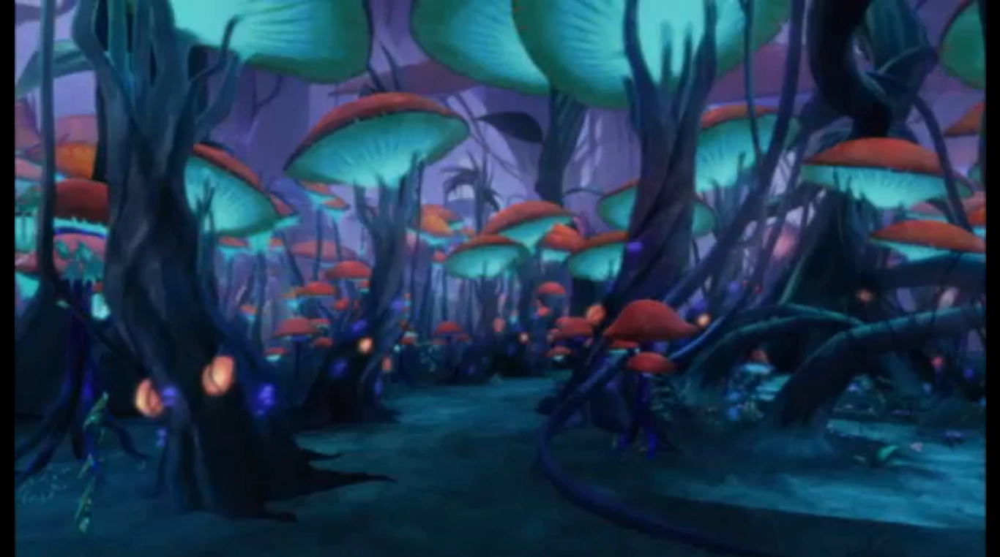
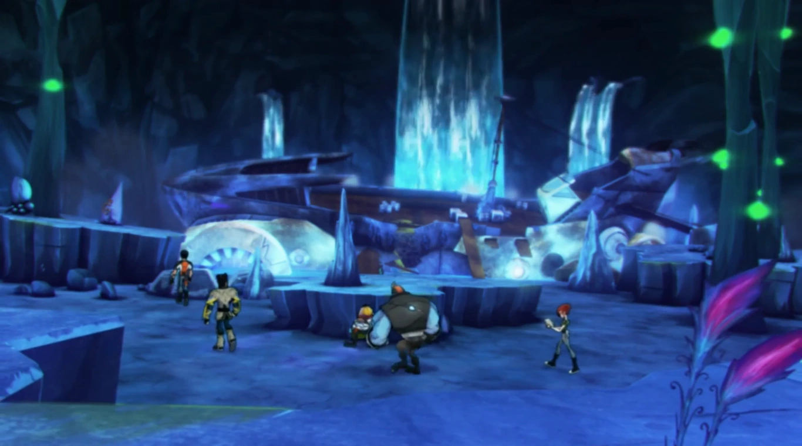
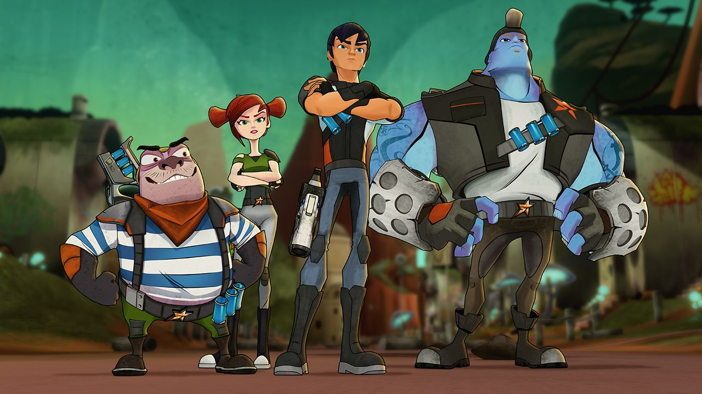

# Cavern reference board

Actual reference images were downloaded, opened and inspected before the continuation’s environment work. Originals are retained without pixel conversion. Exact source URLs and SHA-256 hashes are in [reference-assets.json](reference-assets.json). Cave identity from Wiki-file attribution is kept separate from what the image itself proves.

## Dark Spores Cavern

[Indexed source page](https://slugterra.fandom.com/wiki/Dark_Spores_Cavern) · original reference: 1366 × 762 WebP. The Wiki article could not be fetched; the exact image file returned HTTP 200.

Visible observations:

- Dense branching trunks and root-like shapes create dark framing on both sides; an open winding ground corridor leads into the scene.
- Large mushrooms have warm muted red/orange caps, luminous turquoise undersides and dark irregular stems. Foreground caps extend beyond the frame, establishing scale.
- Teal ground and blue-green middle distance recede into violet haze. Brightness concentrates on cap undersides and scattered smaller growth, while foreground trunks stay dark.
- Organic silhouettes and repeated canopy layers communicate depth before fine surface detail. This is a mushroom forest, not a field of giant crystals.

Implementation interpretation: layered irregular canopy geometry, roots framing traversable gaps, local cap lighting and atmospheric separation. Exact plant names, dimensions, path connections and encounter placements are game design. **Do not rename this reference Wild Spores Cavern** or infer that all 99 caverns share this biome.

## Pyrite Cavern

[Indexed source page](https://slugterra.fandom.com/wiki/Pyrite_Cavern) · original reference: 1366 × 762 WebP. The exact image file returned HTTP 200; direct article access remained unavailable.

Visible observations:

- A monumental cool-blue interior contains stepped rock platforms, tall columns and a dark high ceiling.
- Bright cyan vertical waterfall curtains dominate the rear composition. The foreground is a broad walkable-looking shelf with smaller raised layers beyond it.
- A large fragmented built-looking form spans the middle distance. Human-scale figures near it establish scale.
- Violet leaves occupy one edge; isolated green lights dot vertical structures. Warm color is sparse, keeping the luminous water and scale as the main focus.

Implementation interpretation: a contrasting spacious cavern, layered terraces, waterfall landmarks and restrained foreground vegetation. The still does not prove that blue stone is ice, establish the broken structure’s identity, or supply a navigable map. New bridges, gates and quest routes are designed additions.

## Character and equipment identity

[ABC iview source](https://iview.abc.net.au/show/slugterra/series/1/video/ZX9896A004S00) · 1280 × 720 JPEG, HTTP 200.

Pronto is short and broad with a moustache, striped shirt and orange scarf; Trixie is slim with auburn side buns and green/gray clothing; Eli has dark hair and black/orange clothing; Kord is much taller and broader with blue skin and oversized bracers. Cyan canisters recur on equipment. These distinct silhouettes, bold costume blocks and expressive faces should survive higher environment detail. The still is not a neutral turnaround and its backdrop has no confirmed cavern identity here.

The [official blaster product image](../../src/assets/references/eli-blaster-official.jpg), from the [official Slugterra store](https://www.slugterra.com/), shows orange/blue/gray housing, a cylindrical cyan canister and a circular chamber. It is a toy photo: plastic finish and product proportions are not exact animation-model specifications.

## Creature forms

The asset manifest also includes actual normal/transformed pairs for Infurnus, Tazerling, Boon Doc, Frostcrawler and Phosphoro from the primary legacy arsenal pages. Retain the source-specific eyes, head shapes, appendages and transformed silhouettes; avoid implementing every species as the same body with different colors. Frostcrawler’s transformed white jagged mantle and Phosphoro’s broad spotted ray-like form are especially different from the existing three models.

## Environmental target

Pursue the requested cinematic immersion through large connected spaces, layered depth, coherent landmarks, nearby detail, water and spatial sound. Keep Slugterra’s underground architecture, readable animated forms, distinct slug companions and chunky technology. These references support a richer Slugterra; they do not establish Avatar geography, species, architecture or assets as part of the setting.
