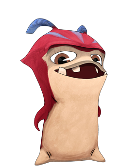
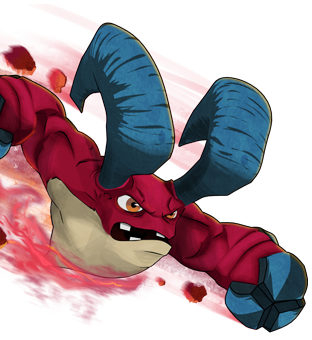
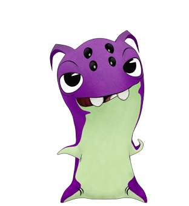
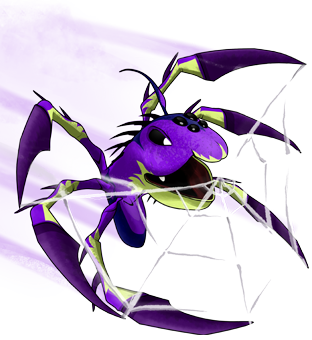
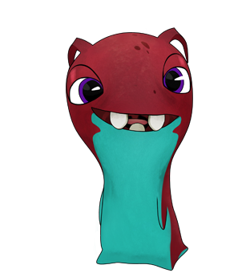
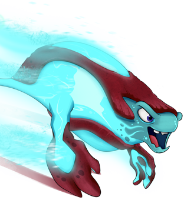

# Cavern and companion expansion research — 2 November 2026

This expansion continues the existing game and its reference collection. Canonical source facts, observed artwork and original playable layouts remain separate. No scripts or instructions from uploaded model archives were executed as task instructions.

## Three companions from the legacy official arsenal

The Disney-hosted Slug Arsenal profiles returned HTTP 200 on 2 November 2026. They identify NerdCorps in author metadata and directly supply the normal/transformed artwork paths. These are historical official source classifications, rather than a new invented element taxonomy.

| Species | Source element | Source power and habitat | Implemented interpretation |
| --- | --- | --- | --- |
| [Rammstone](https://dolimg.com/media/en-US/games/html5/slugarsenal/rammstone.html) | Earth | Ramming; rocky crevasses. The source describes curved ram horns, rocky fists, uppercuts, projectile rocks, earthquakes and defensive rock walls. | A heavy ramming companion that staggers and pushes enemies. Damage, push distance and the 1.2-second stagger are RPG tuning. |
| [Arachnet](https://dolimg.com/media/en-US/games/html5/slugarsenal/arachnet.html) | Earth | Spinning webbing and nets; nests in high cliff faces. The source describes web lines, nets, web walls and sticky cocoons that bind opponents. | A distinct web control companion. A 2.6-second movement bind adapts the sourced webbing role; `web` is an effect category, while `sourceElement` remains Earth. |
| [Fandango](https://dolimg.com/media/en-US/games/html5/slugarsenal/fandango.html) | Light | Boosts slug energy; found all over Slugterra. The source says it can act as a slug beacon, improve slug energy in an area and power another slug when fired in tandem. | A support companion that restores shield and temporarily strengthens another companion. The six-second window, 1.25 multiplier and shield amount are original RPG balance; `energy` is an effect category, while `sourceElement` remains Light. |

Fandango's legacy profile contains an ambiguous “Famous Slug: Beeker” field. That field is excluded from the new companion identity; it does not redefine the existing AquaBeek companion or equate species with named individual slugs. The profiles also contain obsolete PHP warning text, which is excluded from the lore facts.

All six original PNGs were downloaded unchanged, opened and visually inspected. [reference-assets.json](reference-assets.json) records exact source URLs, dimensions, byte sizes and SHA-256 values; [canonical-source-catalog.json](canonical-source-catalog.json) records source classifications separately from gameplay statistics.

| Species | Protoform observations | Velocimorph observations |
| --- | --- | --- |
| Rammstone | Red hood/shell, cream face and belly, short curved blue horns, small tooth tips. | Muscular red ram-like body, enormous swept blue horns and slate-blue rocky fists. |
| Arachnet | Purple shell, pale lime belly, large side eyes and four small dark forehead eyes. | Long angular purple/lime spider limbs, feelers and visible white web strands. |
| Fandango | Maroon head/back, teal belly, violet eye detail and small uneven teeth. | A long cyan luminous energy form with a maroon dorsal stripe and swept appendages. |

## Two named show caverns

The directly retrieved [episode catalogue](https://en.wikipedia.org/wiki/List_of_Slugterra_episodes) supplies the following secondary evidence:

- **Quiet Lawn Cavern:** the “The Slugout” synopsis names it as Red Hook's home when Eli needs his blaster repaired, and describes the Hooligang threat. The “Dark as Night” synopsis also names Quiet Lawn and Red Hook's blaster work.
- **Snowdance Cavern:** the “Snowdance” synopsis names the cavern, its drive-in theatre, Ice Ogres and Slyren slugs that can put the ogres to sleep. This supports a frozen cavern setting and the location name. It does not establish the geometry of this game's ice passage.

The new playable green terraces in Quiet Lawn and glacial route in Snowdance are original environment designs. Their passage graph, checkpoints, defenders, discoveries and encounter placements are also original. Existing Haven, Dark Spores and Pyrite connections are retained; the new route links Dark Spores ↔ Quiet Lawn ↔ Snowdance ↔ Pyrite.

Direct Wiki articles and file-redirect endpoints returned HTTP 402. No verified still of either new cavern was recovered, so their atlas illustrations are identified as exploration concepts rather than claimed as show screenshots. No images from unrelated search results were used. “Cryo Cavern” and “Shanehide” were considered as leads but were not promoted into this expansion without stronger direct evidence for those names.

The official [WildBrain season-four announcement](https://www.wildbrain.com/trade-news/family-chrgd-slugs-it-out-with-the-season-four-premiere-of-slugterra-october-4) remains a primary anchor for the 99 caverns, Gateway Cavern, the Shane Gang and the Shadow Clan conflict. The official [Slugterra website](https://www.slugterra.com/) returned HTTP 200. The official YouTube channel could not be opened through this environment's proxy; no alternate access path was used. Broadcaster/retailer searches did not yield a directly accessible Snowdance/Quiet Lawn episode synopsis, so the cavern-specific confidence remains secondary episode-catalogue evidence.

## Lore-informed feature direction

The three new power roles provide concrete mechanical differences: Rammstone interrupts and pushes, Arachnet binds movement, and Fandango supports another companion. Their visuals follow the opened official artwork, including distinct battle silhouettes.

Opposing slingers are consistent with the show's recurring duels and antagonistic groups such as the Hooligang. New humanoid outlaws in this RPG are original characters; their patrol routes, pursuit, aiming tells and gear are gameplay design, rather than recreations of Billy, Shorty, Glasses or other named characters.

The primary [WildBrain game announcement](https://www.wildbrain.com/trade-news/dhx-media-unleashes-slugslinger-showdown) establishes transformation at **100 mph**, exploration, collecting/training companions, duels and gear upgrades. Numerical acceleration, audio cue offsets, cooldowns and damage multipliers remain authored game timing and balance. Audio synchronization should preserve that velocity threshold while starting the supplied shot recording when the companion leaves the blaster.
